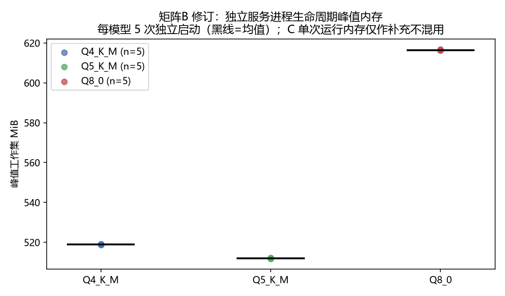
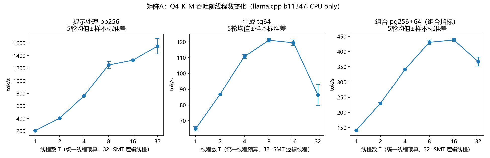
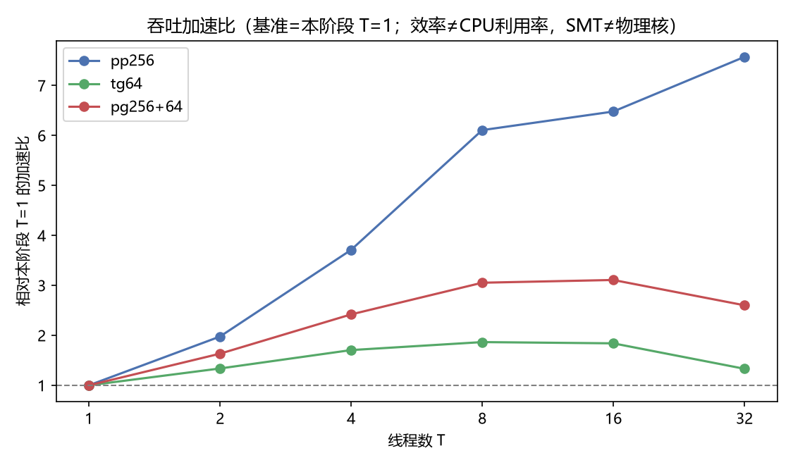
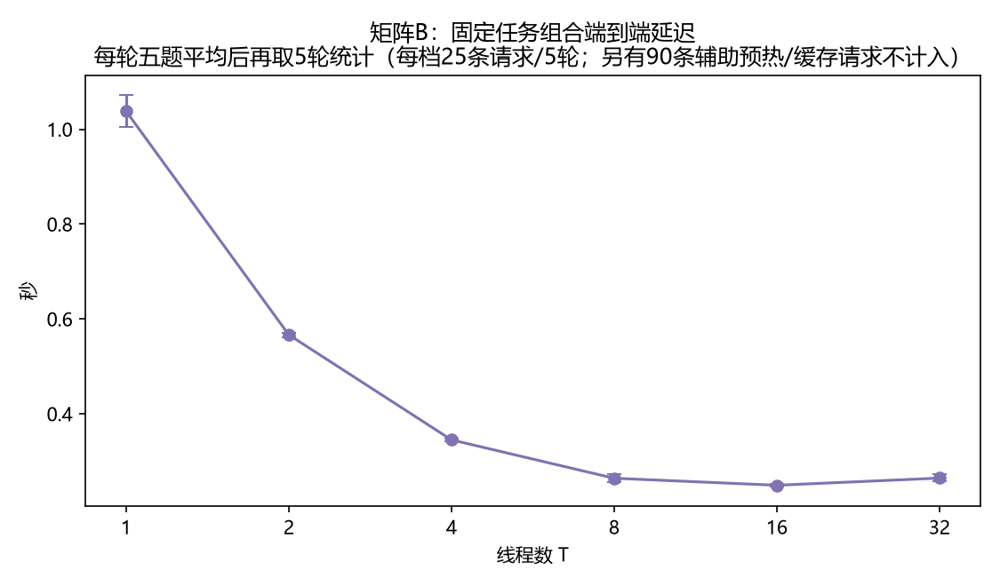
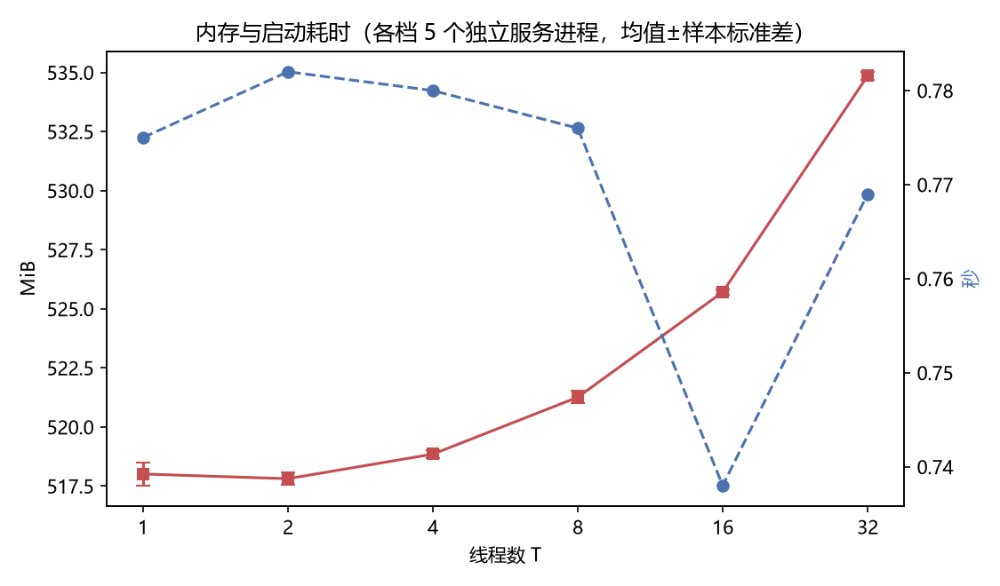

# 小模型量化与 CPU 推理性能实验 · 最终报告

课题14｜《计算机技术与应用》大模型期末大作业｜2026 年 10 月

> 本报告所有数字均来自原始运行记录的**重算值**（离线审计
> `results/summary/audit_stage5_v2/`：31/31 项核验通过、含完整组合
> 集合比对与评分器哈希门控；v1 审计 40/40 项保留作历史），
> 自动核对范围以 `audit_stage5_v2/report_tables.json` 为界，
> 分析脚本显式绑定 run_id（见 §11 与 `docs/EVIDENCE_INDEX.md`），
> 不自动选取"最新目录"，不用 0 填充缺失测量。

---

## 1. 问题与范围

在普通 CPU 上运行同一个约 0.5B 参数的小语言模型（Qwen2.5-0.5B-Instruct），
回答两个问题：

1. **量化版本对照**：官方 GGUF 的 Q4_K_M / Q5_K_M / Q8_0 三个预量化版本，
   在文件大小、进程内存、提示处理速度、生成速度、端到端延迟与简单任务
   质量上有什么差别？
2. **线程参数实验**：固定 Q4_K_M，统一 CPU 线程预算 T ∈ {1, 2, 4, 8, 16, 32}
   如何影响上述性能指标？

**明确不在范围内**：自行实现量化、浮点基线对照（无未量化 GGUF 运行）、
上下文长度扫描、两类线程独立调优、多请求并发、模型训练。

## 2. 环境与模型来源

| 项 | 值 | 证据 |
| --- | --- | --- |
| 机器 | AMD Ryzen 9 9955HX（16 物理核 / 32 SMT 线程），32 GB 内存（31.18 GiB），Windows 11 家庭中文版 Build 26100 | `environment/system_info_v2.json` |
| 后端 | llama.cpp `0.5.0-dev (build 11347, commit 5fc4f3c8c)`，官方 GitHub Actions Windows CPU x64 预编译包，未编译未修改 | `environment/backend_manifest.json`（50 个 exe/DLL 全量 SHA256） |
| GPU | 无（CPU-only 构建 + `-ngl 0` + `--list-devices` 返回 none） | 同上 |
| 模型 | Qwen/Qwen2.5-0.5B-Instruct-GGUF，仓库 revision `9217f5db79a29953eb74d5343926648285ec7e67` | `models/model_manifest_v3.json` |
| 许可 | 模型 Apache-2.0；llama.cpp MIT | `docs/DATA_AND_LICENSE.md` |

三个模型文件均与**官方 huggingface.co API 的 LFS 元数据逐字节比对一致**
（官方独立核验通过；下载经 hf-mirror.com，下载 URL 与核验 URL 分开记录）：
Q4_K_M 491,400,032 B（468.64 MiB）、Q5_K_M 522,186,592 B（498.00 MiB）、
Q8_0 675,710,816 B（644.42 MiB）。

## 3. 实验控制

- **单推理进程、单 slot（`--parallel 1` 显式覆盖默认 auto）、串行请求**；
- CPU-only；server 显式 `-lm mmap`；llama-bench **本次命令未显式传入
  `-lm`**（该工具不提供该参数），加载模式为其内部默认——两条路径
  分别如实记录，不宣称统一；
- 缓存：`--cache-reuse 0` + 请求体 `cache_prompt:false`，每次服务启动后
  以"同一提示连续两次"核实 `cache_n=0` 且第二次完整重算；
- 生成：temperature=0（贪心）、top_p=1、seed=42、max_tokens=96（Stage 3/4
  统一）；Flash Attention 显式 off（bench 与 server 统一）；
  KV 类型 f16、batch 2048 / micro-batch 512 显式固定；
  `ctx=1024` 仅适用于 server/HTTP 正式矩阵（llama-bench 命令未显式
  传入 `-lm` 与 `-c`，其上下文由负载隐式决定 d+p+n=320）；
- 每次真实运行唯一 run_id、独立目录；run 目录创建拒绝覆盖；
- 正式运行前 preflight 门禁：冻结清单哈希、模型 SHA256、后端指纹与
  **实时**版本核验、硬件复核；任一不通过即拒绝（Stage 3/4 各发生过
  真实拒绝案例，见 §8）。

**冻结与追溯的如实说明**：数据集/模板/评分器/配置/计划的 SHA256 分
Stage 2/3/4 三份冻结清单管理。当前冻结清单校验通过**不等于**已证明历史
冻结过程完整——矩阵 C 运行时刻没有独立的运行时快照留存（详见
`docs/stage3_analysis_revision.md` §6 与 `docs/stage5_resume_review.md`），
可用的间接证据是各正式 run 记录的 `preflight_passed=true` 与 git 历史
连续性；此限制不掩饰、不补造。

## 4. 指标定义（边界与来源）

| 指标 | 边界 | 来源 |
| --- | --- | --- |
| `server_startup_to_ready_s` | 进程启动 → /health 200（含后端内置 warmup）；**不称纯模型加载时间** | 客户端计时 |
| `backend_model_init_interval_s` | 服务端日志 `loading model → model loaded` 区间（含初始化开销，边界未核实）；`model_load_time_s` 因此**保持缺失**并记录原因 | 服务端日志 |
| 端到端延迟 | 单条 HTTP 请求（含模板组装/推理/序列化），不含启动与清理 | 客户端计时 |
| 提示处理/生成速度 | 仅取后端自报 `timings.prompt_per_second` / `predicted_per_second`；缺失/非有限/`predicted_n≤1` 时记 null 并标注，**不猜算** | 服务端 timings |
| 进程峰值内存 | `peak_wset`（进程生命周期峰值），另有 0.05s 间隔采样峰值；两者均不当作单请求峰值 | psutil |
| llama-bench pp/tg/pg | pp=提示 token 数、tg=生成 token 数、pg=先 pp 后 tg 的**组合指标**（不称生成速度）；无 `-c` 参数，上下文隐式 | bench JSON（含逐重复 samples） |

评分三档（格式/内容/联合）的完整口径、分母规则（失败/超时/截断全部计入）
与 JSON 解析规则预注册于 `scripts/score_answer.py` 文档头与
`docs/EXPERIMENT_PROTOCOL.md`。

## 5. 数据集与评分规则

- **开发集 10 题**（`datasets/dev/dev_tasks.json`）：单字段 3 / JSON 3 /
  分类 2 / 规范化 2，仅用于口径调试；
- **正式测试集 50 题**（`datasets/test/test_tasks.json`，`test_tasks_v2`）：
  单字段 15 / 多字段 JSON 15 / 限定标签分类 10 / 日期数字规范化 10；
  题目自建，答案可由题面唯一确定，含干扰项、缺失字段（单字段"未提供"
  与 JSON null 两种形态）与补零等边界；
- 提示模板冻结（`datasets/prompt_template.json`），system prompt 固定，
  使用模型内嵌 ChatML 模板（三量化版本 `/props.chat_template` SHA256 一致）；
- 评分器不调用模型、不改写答案、不重试；JSON 重复键按 Python 语义
  （后者覆盖）、NaN/Infinity 可解析为预注册口径；
- 全部题目的"渲染提示—输入—金标—评分规则"一致性由
  `scripts/validate_datasets.py` 静态校验。

## 6. 量化对照（Stage 3，正式）

run 绑定：A `…112023_stage3benchA_a9c6c1`；B `…112135_stage3perfB_0ffb9d`；
C `…112320/112342/112411_formal_Q*`（Q4/Q5/Q8 各 50 题）。

### 6.1 性能（每值来自 5 轮独立测量）

| 工作负载 | Q4_K_M | Q5_K_M | Q8_0 |
| --- | --- | --- | --- |
| pp256（提示处理, tok/s） | 733.57 ± 23.33 | 439.92 ± 9.43 | 774.16 ± 27.05 |
| tg64（生成, tok/s） | **105.36 ± 0.71** | 99.71 ± 0.89 | 82.33 ± 0.88 |
| pg256+64（组合, tok/s） | 324.62 ± 5.43 | 257.09 ± 1.51 | 284.48 ± 3.23 |
| 文件大小（MiB，实际字节） | 468.64 | 498.00 | 644.42 |
| 进程峰值内存（MiB，B 矩阵 5 进程均值±标准差） | 518.93 ± 0.10 | 511.96 ± 0.15 | 616.47 ± 0.22 |

固定任务组合端到端延迟（矩阵 B，每轮五题平均→5 轮统计）：
Q4 **0.3591 ± 0.0042 s**、Q5 **0.5034 ± 0.0034 s**、Q8 **0.3846 ± 0.0039 s**
（每模型 25 条请求 / 5 轮）。

观测：生成速度呈现 Q4 > Q5 > Q8 的排序（本组数据内）；pp 上 Q5 显著低于
Q4/Q8。机制解释（内存带宽、K 量化反量化路径开销）为**待验证假设**——
本实验未测量带宽/频率/温度，不作为已证实事实陈述。



*图：三版本独立服务进程生命周期峰值内存（矩阵 B，每模型 5 次启动，
黑线=均值，单位 MiB）。*

### 6.2 质量（正式 50 题 × 3 模型，150 条请求，0 失败 0 截断）

| 模型 | 格式正确 | 内容正确 | 联合正确 | Wilson 95% CI（联合） |
| --- | --- | --- | --- | --- |
| Q4_K_M | 21/50 | 21/50 | **16/50** | (0.208, 0.458) |
| Q5_K_M | 22/50 | 24/50 | **17/50** | (0.224, 0.479) |
| Q8_0 | 20/50 | 22/50 | **15/50** | (0.191, 0.438) |

配对 McNemar 精确检验（事后探索性，3 组比较、Bonferroni 口径
α≈0.0167；不一致对分别为 5/3/4 个）：Q4 vs Q5 p=1.000（2 vs 3）、
Q4 vs Q8 p=1.000（2 vs 1）、Q5 vs Q8 p=0.625（3 vs 1）——**在本测试集上未检出显著配对差异**。
Wilson 区间重叠仅作描述，不构成等价证明；本结论不外推为
"质量相同""量化无损"，也不适用于其他任务集。

### 6.3 共同输出模式（观察，非结论）

- 分类题：三模型在全部 10 题上都输出了标签列表的**第一个标签**——
  这是一个与正确答案无关的输出位置模式（观察记录，未做顺序敏感性的
  受控验证）；
- JSON 抽取题：三模型的 15 题**全部**以代码围栏输出（预注册口径下计
  格式错误）；
- "未提供"误触发：输入含所需信息时仍答"未提供"（如 test-002/003/
  004 三模型全错；test-001 属另一类错误——输出多了职称后缀），
  50 题中三模型**同错 31 题**。

## 7. 线程实验（Stage 4，正式，Q4_K_M）

run 绑定：A `…121218_stage4bench_a2dc0f`（30 单元/90 测量值）；
B `…121547_stage4http_f03b1a`（30 启动 / 150 计时请求 + 90 辅助请求）。
顺序由种子 20261004 预生成乱序（非 1→32 递增）；T=4 为本阶段同期基准，
Stage 3 的 T=4 仅旁证、不合并。

### 7.1 吞吐（5 轮均值 ± 样本标准差，tok/s）

| T | pp256 | tg64 | pg256+64 |
| --- | --- | --- | --- |
| 1 | 204.78 ± 2.02 | 64.94 ± 1.35 | 141.01 ± 1.41 |
| 2 | 404.68 ± 3.93 | 86.82 ± 0.33 | 230.23 ± 2.03 |
| 4 | 759.79 ± 11.51 | 110.71 ± 1.29 | 341.12 ± 1.73 |
| 8 | 1250.60 ± 58.64 | **121.08 ± 1.14** | 430.49 ± 7.36 |
| 16 | 1326.69 ± 15.75 | 119.47 ± 1.83 | 438.32 ± 5.00 |
| 32 | **1550.62 ± 123.60**（CV≈7.97%） | 86.41 ± 6.77 | 366.93 ± 15.19 |

（加速比，对本阶段 T=1：pp 1.00/1.98/3.71/6.11/6.48/**7.57**；
tg 1.00/1.34/1.70/**1.86**/1.84/1.33；pg 1.00/1.63/2.42/3.05/3.11/2.60。
按线程归一化的效率不是 CPU 利用率；32 为 SMT 逻辑线程实验点。）

观测：pp 随线程数持续上升至 T=32（并行算力受益）；tg 在 T=8 达峰后
**回落**（T=32 甚至低于 T=2 水平）——与"生成阶段受内存带宽约束、
超订后往返开销上升"的假设一致，但带宽/频率/温度未实测，
仅作为待验证假设提出。



*图：三工作负载吞吐（tok/s）随统一线程数变化；点=5 轮均值，
误差条=样本标准差；横轴为对数刻度，32 为 SMT 逻辑线程实验点。*



*图：相对本阶段 T=1 的加速比（虚线=1.0 基准）。*



*图：矩阵 B 固定任务组合端到端延迟（秒）；每轮五题平均后再取 5 轮
统计，误差条=样本标准差；每档 25 条请求/5 轮（另有 90 条辅助请求
不计入）。*



*图：进程峰值内存（MiB，左轴）与启动到就绪时间（秒，右轴），
各档 5 个独立服务进程，误差条=样本标准差。*

### 7.2 实际任务延迟与内存

固定任务组合（dev-001/003/004/007/009，每轮五题平均后再对 5 轮统计；
贪心解码下各档输出逐字一致、token 数相同，对比干净）：

| T | 1 | 2 | 4 | 8 | 16 | 32 |
| --- | --- | --- | --- | --- | --- | --- |
| 组合延迟 (s) | 1.038 ± 0.034 | 0.567 ± 0.005 | 0.345 ± 0.003 | 0.264 ± 0.009 | **0.249 ± 0.003** | 0.264 ± 0.008 |
| 进程峰值内存 (MiB) | 518.0 | 517.8 | 518.9 | 521.3 | 525.7 | **534.9** |

内存随线程档缓增（+17 MiB @T=32）；启动到就绪时间各档均在亚秒~2 秒级
（见 `stage4_summary.json::startup_per_tier`）。

## 8. 失败与边界案例

### 8.1 程序/执行层面（区分：测量单元无失败 ≠ 执行全程无故障）

1. **Stage 2 llama-bench 参数试错**：`-tpp` 与 `-c` 先后传入不存在于
   b11347 的参数而失败（`results/raw/run_20261003_001547_benchdev_a9098f/`、
   `run_20261003_001617_benchdev_9a1e2f/`），据此核实 pp/tg/pg/depth 语义；
2. **Stage 4 bench 汇总统计故障**：30 个测量单元全部成功，但首轮
   `result.json` 误报 `measurements_total=0`（汇总从内存摘要取值而非
   落盘记录）→ 修复汇总重建逻辑并经 `--resume` 真实恢复
   （指纹核对→跳过 30 个完整单元→重建 90/90）。**测量单元无失败，
   但执行过程发生过这次汇总失败**——两者不混称；
3. **preflight 真实拒绝**：Stage 3 两次（缺修正文档、缺模型清单 v3）、
   恢复前因代码修订重冻结后重新通过——门禁按设计拦截。

### 8.2 模型任务层面（正式测试集原始输出，证据：
`results/summary/audit_stage5/case_outputs.json` 及对应 requests.jsonl）

| # | task_id | 输入要点 | 标准答案 | 三模型真实输出 | 判分理由 |
| --- | --- | --- | --- | --- | --- |
| 1 | test-003 | 通知含"电话 8794-2210" | 8794-2210 | 三模型均"未提供" | 信息实际存在，误触发缺失回答；计入内容错误 |
| 2 | test-001 | "主讲人为…赵启明教授" | 赵启明 | 三模型均"赵启明教授" | 按预注册无单位/无附加规则，职称后缀属答案外内容 |
| 3 | test-006 | 容量80人、已选73人 | 7（含推导，题目已标注） | 三模型均"80" | 未完成 80−73 推导，复制了容量字段 |
| 4 | test-046 | "一百万零一" | 1000001 | Q4 "100001"、Q5 "1000001"✓、Q8 "1000010" | 中段补零边界；三模型两种不同失败形态 |
| 5 | test-048 | "2GB→MB" | 2048MB（规则明确要求带单位） | Q4 "2048MB"✓、Q5/Q8 "2048" | 与单字段无单位规则不同，本规则显式要求单位；Q5/Q8 违反题目规则 |
| 6 | test-049 | "25摄氏度→华氏度，保留一位小数" | 77.0 | Q4 "77.0华氏温度"、Q5 "77.0"✓、Q8 "77.0华氏度" | 数值全对；Q4/Q8 添加答案外单位文字 |
| 7 | test-050 | "四分之三→小数" | 0.75 | Q4/Q8 "0.6"、Q5 "0.6666666666" | 三模型全错：混淆 3/4 与 3/5、3/4 与 2/3 |

（以上均不因已看到正式答案而修改题目、评分器或提示。）

## 9. 配置建议（针对本机，限定适用范围）

**按指标分别给出最佳观测档位**（不强制同一档位）：

- 生成吞吐（tg64）：**T=8**（121.08 tok/s，较 T=1 提升 1.87 倍）；
- 组合工作负载（pg256+64）：按 3% 实用规则推荐 **T=8**
  （430.49 vs 最佳 438.32 @T=16，差距 1.8%）；
- 固定任务组合最低延迟：**T=16**（0.249s；T=8 为 0.264s，差约 6%，
  超出 3% 阈值）；
- 纯提示处理吞吐（pp256）：**T=32**（1550.6±123.6 tok/s，CV≈8%，
  注意其波动明显大于其他档位）。

**综合建议 T=8**：这是**偏重生成吞吐与线程开销控制的实用选择**——
它在最常用的生成与组合指标上最优或处于 3% 阈值内，延迟仅比最佳档慢
15ms，且内存最低档附近。**不是所有指标都满足 3% 规则**（pp 最佳在
T=32、延迟最佳在 T=16），也**不是全组合最优的证明**；对纯批量提示处理
或极端延迟敏感场景应分别选 T=32 / T=16。内存敏感时注意线程越多峰值
内存越高（T=32 时 +17 MiB）。3% 为实用选择阈值，不是统计等价证明。

## 10. 局限（如实陈述）

1. **无独立未量化基线**：Q8_0 仍是量化模型；所有"量化损失"类推断
   都缺少 f16 原模型对照，仅能比较三种量化等级之间的差异；
2. **测试集规模与范围有限**：50 题自建短任务集（抽取/分类/规范化），
   覆盖不了长文本、多轮对话、代码、数学推理等能力；统计功效低
   （联合正确率差 1 题=2 个百分点）；
3. **未做上下文扫描**：全部请求 ctx=1024、短输入；长上下文下结论
   （尤其 prefill 行为与 KV 内存）不适用；
4. **线程实验仅针对 Q4_K_M**：其他量化档的线程行为未测；
5. **未隔离频率/温度/带宽**：笔记本无散热/功耗控制实验，长跑降频、
   后台负载等混杂因素未量化；机制解释均为待验证假设；
6. **追溯限制**：矩阵 C 运行时刻无独立冻结快照；`stage4_exec --resume`
   存在"核对当前清单而非原快照、覆盖快照、重置开始时间"的已记录限制
   （`docs/stage5_resume_review.md`）；恢复证据仅支持"跳过 30 个完整
   单元并重建 90 个测量值"；S4_A 重建汇总中的"原始开始时间"实为恢复
   时刻（原始 12:12:18 的开始只留存于 run_id 与文件时间戳）；
7. **资源监控口径**：HTTP 单元有前后资源快照，bench 单元只有开始快照；
   快照不含 CircuitPilot 与电源字段。正式运行开始前有过带时间戳的
   交互式检查（当时无 CircuitPilot 进程、AC 供电），但该检查输出
   **未归档入交付包，无法由交付内容独立核验**；不以当前检查补作
   全程证明；
8. 测量单元层面无失败，但执行过程发生过汇总统计故障与门禁拒绝
   （§8.1），均已如实记录并修复/按预案处理。

## 11. 复现方法

环境与依赖、模型获取与哈希核验、各阶段命令（含"哪些命令会启动推理"
的明确标识）见仓库 `README.md`；证据索引（每张表图的 run_id、原始
文件、分析脚本与统计口径）见 `docs/EVIDENCE_INDEX.md`。
核心命令：

```bash
# 只检查、不推理
.venv/Scripts/python.exe scripts/stage4_preflight.py
.venv/Scripts/python.exe scripts/audit_stage_results.py       # 离线审计（重算全部数字）
# 会启动推理（llama-server / llama-bench）
.venv/Scripts/python.exe scripts/smoke_test.py
.venv/Scripts/python.exe scripts/run_stage3_bench.py
.venv/Scripts/python.exe scripts/run_tasks.py --dataset datasets/test/test_tasks.json \
    --config configs/formal_config.json --formal --model-key Q4_K_M
.venv/Scripts/python.exe scripts/stage4_exec.py --matrix bench|http
```

## 12. 参考来源

- Qwen 官方 GGUF 仓库：<https://huggingface.co/Qwen/Qwen2.5-0.5B-Instruct-GGUF>（Apache-2.0）
- llama.cpp（ggml-org/llama.cpp，MIT）：b11347 release 与 `--help` 证据
  （`environment/evidence/`）
- 课题指南：《计算机技术与应用_大模型期末大作业课题指南》（课题14）
- 镜像说明：hf-mirror.com 仅用于下载通道，核验以官方 API 元数据为准

## 13. AI 辅助说明

本项目的全部代码、实验执行与文档由 AI 编码助手（GLM，经 ZCode 交互
环境）在人工指定的阶段目标、约束与验收清单下辅助完成；交付前另有一轮
**AI 审查（Codex）**对测试入口划分、审计口径、重建工具与交付文字提出
修正清单并已逐项落实（`docs/stage5_closeout_revision.md`）；人工负责阶段
划分、约束制定、关键决策确认与结果审查。所有自动判定（评分、完整性
校验）都有可复算的原始记录，并经独立重打分/审计脚本交叉核验
（150 条正式输出重打分零不一致；40 项审计核验全部通过）。
小组成员姓名、学号与个人分工**待填写**（见
`docs/CONTRIBUTIONS_AND_AI.md`），不在此编造。
