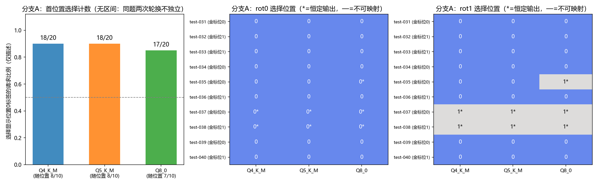
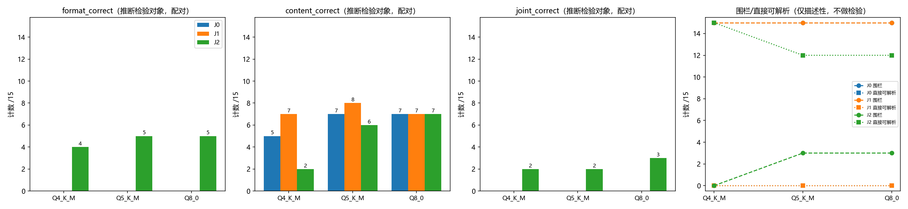

# Stage 6 分析修订报告（离线，零推理）

日期：2026-10-04。基线不变：rev4（942573d）。原始记录、预注册计划
（`configs/stage6_plan.json`）、冻结清单、旧分析脚本与旧汇总**全部保留原位，
未重新冻结任何材料**。本修订只新增：

- 修订脚本：`scripts/stage6_analyze_revision.py`、`scripts/stage6_trace_export.py`、
  `scripts/stage6_verify_revision.py`
- 修订输出目录：`results/stage6/rev/`（汇总、CSV、图、追溯副本、核验报告）
- 本报告：`docs/STAGE6_ANALYSIS_REVISION.md`

旧产物 `results/stage6/stage6_summary.json`、`results/summary/stage6_*.csv`、
`plots/stage6_*.png` 与 `docs/STAGE6_DIAGNOSIS_REPORT.md` 保留不覆盖；
替代关系见 §5。

## 1. 修订一：分类分析统计口径

**记录原计划的内部冲突**：预注册 `branch_A_statistics` 同时写了
"以原始题目为统计单位、按题配对；同题多排列与三模型不能当作独立题目扩充
样本量" 与 "比例报告 Wilson 95% CI"——后者以 n=20（10 题 × 2 轮换）做汇总
二项区间，把同题两次轮换当独立样本，与前者矛盾。旧报告按 n=20 给出
Wilson CI 并在图中画了误差条。**本次修正**：撤销区间与误差条，按更严格的
单位规则（题）执行；未追加任何为获得显著性而选择的新检验。

### 1.1 保留的描述性计数

| 模型 | 选显示位置0 | 位置1 | 不可映射 |
| --- | --- | --- | --- |
| Q4_K_M | 18/20 | 2 | 0 |
| Q5_K_M | 18/20 | 2 | 0 |
| Q8_0 | 17/20 | 3 | 0 |

### 1.2 主要展示：按题配对（每模型 10 题）

| 模型 | 随位置（两轮换均选显示首标签） | 恒定输出（两轮换同一标签） |
| --- | --- | --- |
| Q4_K_M | **8/10**（031–036、039、040） | 2/10：test-037/038 始终"正面" |
| Q5_K_M | **8/10**（同上） | 2/10：test-037/038 始终"正面" |
| Q8_0 | **7/10**（031–034、036、039、040） | 3/10：test-037/038 始终"正面"、test-035 始终"紧急" |

K=2 下两类互斥且并集为全部 10 题。test-037/038 在两种顺序下 4/4 请求输出
"正面"（其一恰与金标一致、其一错误）——**描述为"始终输出正面"，不以其一
答对推断语义理解**。test-035 rot1 上 Q8 输出"紧急"是全部 60 请求中唯一一次
与显示首位置不符且与金标一致的输出，单例不构成证据。联合正确 rot0→rot1：
Q4 5→5、Q5 5→5、Q8 5→6。

**McNemar 口径限定**：rot0 vs rot1 的精确 McNemar（Q4/Q5 b=4,c=4；Q8 b=3,c=4；
p=1.0）比较的是**两轮换下正确率的变化**。p=1.0 只说明正确率无净变化
（纯位置跟随的预期形态是正确率随金标位置整体平移、净效应为零），
**不能据此证明位置偏好**；位置偏好的证据是上表的描述性逐题模式。

## 2. 修订二：JSON 分析的 Holm 分族

**旧缺陷**：`stage6_analyze.py` 把 format 与 joint 两个指标的 p 值合并成一个
6 值族做 Holm（得格式 J1→J2：Q4 0.75、Q5/Q8 0.375），与预注册
"每模型×每指标族内 3 次比较做 Holm 校正"不符。**本修订按预注册分族**：
每模型 × 每指标（format_correct / content_correct / joint_correct）× 3 个比较
（J0→J1、J1→J2、J0→J2）为独立 3 值族，共 27 个检验；内容指标为按预注册
"补齐"的配对结果（旧版只对 format/joint 做了检验）。每族成员、原始 p、
校正值保存于 `stage6rev_mcnemar_families.csv` 与修订汇总。

| 模型 | 指标 | J0→J1 | J1→J2 | J0→J2 |
| --- | --- | --- | --- | --- |
| Q4_K_M | 格式 | 1.00→1.00 | 0.125→**0.375** | 0.125→**0.375** |
| Q4_K_M | 内容 | 0.50→0.50 | 0.0625→**0.1875** | 0.25→0.50 |
| Q4_K_M | 联合 | 1.00→1.00 | 0.50→1.00 | 0.50→1.00 |
| Q5_K_M | 格式 | 1.00→1.00 | 0.0625→**0.1875** | 0.0625→**0.1875** |
| Q5_K_M | 内容 | 1.00→1.00 | 0.625→1.00 | 1.00→1.00 |
| Q5_K_M | 联合 | 1.00→1.00 | 0.50→1.00 | 0.50→1.00 |
| Q8_0 | 格式 | 1.00→1.00 | 0.0625→**0.1875** | 0.0625→**0.1875** |
| Q8_0 | 内容 | 1.00→1.00 | 1.00→1.00 | 1.00→1.00 |
| Q8_0 | 联合 | 1.00→1.00 | 0.25→0.75 | 0.25→0.75 |

（单元格为 原始 p→Holm 校正 p。）全部 27 个检验校正后均 ≥0.1875，
**没有任何指标达到显著**。与用户核对值一致：格式 J1→J2 与 J0→J2
Q4=0.375、Q5/Q8=0.1875。

**推断检验范围声明**：推断检验（精确 McNemar + 族内 Holm）仅作用于每题
配对的二元正确率三口径（格式/内容/联合）。**围栏出现比例、直接可解析比例、
completion_tokens 仅描述性，不做检验**；"围栏从 15/15 降到 0–3/15"是描述性
变化，不得与"格式正确率检验不显著"混为一谈——两者口径不同（围栏是输出
形态计数；格式正确还要求无多余/错名字段，Q4 J2 直接可解析 15/15 但格式仅
4/15，差在示例字段名泄漏造成的字段集改变）。

## 3. 修订三：结论措辞

1. **撤销"剂量响应成立"**：J1 未降低围栏率（15/15→15/15，三模型格式转移
   0/0/0）；J2 减少围栏（15/15→0–3/15，描述性；残余为 Q5/Q8 各 3 题
   test-017/020/025）；**完整的渐进改善预测未获支持**（J1 环节无改善）。
2. **J1 无效仅限定于围栏/格式指标**：内容层面 J0→J1 有零星变化
   （Q4 test-019/025 错→对；Q5 test-024 错→对；Q8 无），原样保留报告。
3. **用具体计数替代定性说法**："Q8 最稳"→ J1→J2 内容对→错 Q4 5 题
   （test-019/021/023/025/030）、Q5 3 题（021/023/024）、Q8 1 题（021）；
   Q4 含 2 例示例字段名改写（test-024 输出 `{"物品名称": "二等座", …}`、
   test-025 输出 `{"物品名称": "轻笔记App", "安装期限": …}`）；"三版本无实质
   差异"→ 19/20 题×轮换单元三模型同标签，偏离请求 Q4 2、Q5 2、Q8 3。
4. **内容变化按基线分开**：以 J0→J2 为基线（Q4 对→错 021/023/030）与以
   J1→J2 为基线（Q4 对→错 019/021/023/025/030——其中 019/025 是先在 J1
   变对又在 J2 变回错的净回归）不是同一组题；两口径均列出，不混用。

## 4. 修订四：执行账目

按 7 个 run 重新核算（逐 run 明细见修订汇总 `ledger` 字段与
`stage6rev_summary.json`）：

| 类别 | 旧报告 | 修订后 |
| --- | --- | --- |
| 任务请求 | 195 正式 + 52 开发（旧报告把开发算入"辅助"） | **247**（正式 195 + 开发 52） |
| 辅助请求 | 70（=39+13+18，其中 18 按 6 次启动误计） | **21**（7 次启动 × [预热 1 + 缓存检查 2]） |
| 总数 | 265 | **268** |
| HTTP 失败 / 超时 / 截断 | 0 / 0 / 0 | 0 / 0 / 0（逐 run 复核） |
| 评分异常 | 未按 run 列出 | **4 条，全部在缺陷 dev 尝试**
  `run_20261004_115756_stage6dev_Q4KM_69930b`（分类变体缺 `labels` 评分别名），
  原始记录保留未覆盖；修复后该模型开发重跑 1 次（Q4 共 2 次 dev run，
  Q5/Q8 各 1 次） |
| 辅助请求字段 | 未说明 | 预热仅记录 ok 标记；缓存检查仅记录 cache_n/prompt_n；
  messages/raw_output/usage 等**未记录**（如实标注，不补造） |

## 5. 新旧结论替代对照

| 旧结论（STAGE6_DIAGNOSIS_REPORT.md） | 修订版 |
| --- | --- |
| §3.1 Wilson CI [0.70,0.97]/[0.64,0.95]、图1误差条 | 撤销（单位冲突）；保留计数 18/20、18/20、17/20 |
| §3.2 McNemar p=1.0（未限定口径） | 限定为正确率变化检验，不证明位置偏好 |
| §3.4 "无实质差异" | 19/20 单元同标签；偏离 Q4 2 / Q5 2 / Q8 3（具体清单） |
| §3.3 "Q8 唯一一次放弃首位置且方向正确" | 单例描述，不作语义理解证据 |
| §4.3 "剂量响应""J1→J2 进一步降低" | J1 环节无改善；J2 去围栏为描述性；渐进预测未获支持 |
| §4.4 "Q8 最稳" | J1→J2 内容对→错 Q4 5 / Q5 3 / Q8 1（具体题号） |
| §1 账目 265/70/6 次启动 | 268 = 247 + 21（7 次启动），口径重分类 |
| §4.2 Holm 0.75/0.375（6 值合并族） | 每指标 3 值族：Q4 0.375、Q5/Q8 0.1875；补内容指标 |

未被替代的旧结论：链路核查结论、dev 验证记录、基线 75/75 一致、J2 示例
泄漏的原始输出案例、J0/J1 围栏 15/15 与 Stage 3 复现、定位红线——修订复核
后均维持（基线本次以 raw_output+finish_reason+completion_tokens 三字段逐字符
重核，仍 75/75）。

## 6. 追溯补强

- **run 内快照缺口（如实声明）**：每个 run 的 result.json 仅含
  `config_snapshot`，无完整计划/变体/冻结清单快照；不补造"当时快照"。
- **事后追溯副本**：`results/stage6/rev/traceability_f92012e/` 由提交 f92012e
  导出（23 个文件 = 冻结#1 清单 22 项 + 清单本身），MANIFEST 标明来源提交、
  导出时间、"不回填原 run、不据此宣称当时已存档"。f92012e 在冻结#1 之后、
  正式运行之前提交且工作区干净，故其内容即门禁实际核验的状态。
- **冻结#1→#2 差异核验**：仅 `scripts/stage6_analyze.py` 条目变化
  （图1标签缺陷修复的已记录重冻结），其余 21 项哈希逐一相同——确认重冻结
  未触碰任何输入/模型/模板/评分材料。
- **审计发现（CRLF 口径）**：`scripts/llama_server_ctl.py` 与
  `models/model_manifest_v3.json` 不在 `.gitattributes -text` 覆盖内，git blob
  为 LF 而冻结清单记录的是门禁核验的工作区字节（CRLF）；LF→CRLF 复原后与
  清单哈希逐一相符（导出脚本内断言，不符即中止）。门禁语义=工作区字节，
  当时核验有效；本发现仅记录，**不据此重新冻结任何历史材料**。

## 7. 强化核验结果（`stage6_verify_revision.py` → `rev/verify_revision_report.json`）

| 项 | 结果 |
| --- | --- |
| V-R1 git diff 942573d..HEAD 范围（仅 stage6 命名新增 + .gitattributes 修改） | PASS |
| V-R2 .gitattributes 差异逐行白名单（仅 3 行追加、零删除） | PASS |
| V-R3 两份冻结清单逐文件通过（文件数动态统计：Stage3 n=21、Stage6 n=22） | PASS |
| V-R4 独立重算 195 条评分（冻结评分器 vs 落盘 score）零不一致 | PASS |
| V-R5 请求矩阵与顺序（3×65 唯一、=变体全集、顺序=冻结顺序、三模型一致） | PASS |
| V-R6 75 条基线实际输出逐字符一致（raw_output+finish_reason+completion_tokens） | PASS |
| V-R7 转移/分族/统计重算 vs 修订汇总；预期值断言（Q4 0.375、Q5/Q8 0.1875）；min Holm=0.1875 | PASS |
| V-R8 离线反例测试（holm 已知答案；3值族 vs 旧6值族反例 0.375/0.75；清单篡改检出；白名单解析器反例）——合成数据仅进临时目录并删除 | PASS（4/4） |
| V-R9 核验前后历史文件哈希快照一致 | PASS |
| V-R10 追溯副本逐字节=git show f92012e；冻结#1→#2 仅 analyzer 条目 | PASS |
| V-R11 账目 247+21=268；评分异常=4 且仅在缺陷 dev 尝试 | PASS |

## 8. 仍存限制

1. 全部 27 个检验校正后均不显著（最小 0.1875）：J2 的去围栏与 Q4 内容损伤
   是描述性效应量，不是已证实的统计结论；n=15/格的 McNemar 功效极低。
2. 分族修正是对预注册口径的落实，不是新的多重比较策略；未追加任何新检验。
3. K=2 轮换无法区分首位置偏好与末位置回避；恒定输出题（037/038/035）的
   机制（词形吸引 vs 语义加工）不可由行为数据区分。
4. Holm 修正在 3 值族内进行；若跨模型/跨指标再合并校正，结论只会更保守。
5. 账目中辅助请求的字段缺失是历史事实（当时未落盘），无法事后补齐。
6. 追溯副本依赖 git 提交字节；两条 CRLF 受影响路径的复原以"LF→CRLF=清单
   哈希"断言为准，若工作区曾存在其他不可归一化差异则无法察觉（当前逐一
   相符，未见此迹象）。

## 9. Git

修订产物在最终提交中；工作区 clean；`git diff 942573d..HEAD` 历史路径零改动
（V-R1/V-R2 复核，.gitattributes 仅预注册时的 3 行追加）。
完成后停止：零推理，未启动任何新实验。
