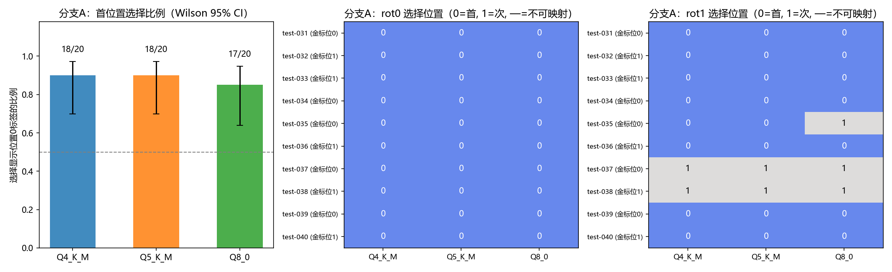
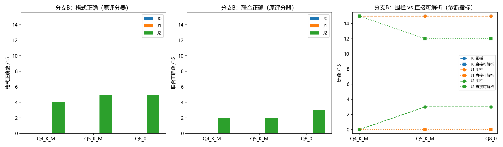

# Stage 6 诊断报告：共同错误诊断实验（事后探索性）

日期：2026-10-04。基线：rev4（942573d）。预注册：`configs/stage6_plan.json` +
`docs/STAGE6_PLAN.md`（提交 f92012e）。机器汇总：`results/stage6/stage6_summary.json`。

**定位红线（重申）**：本轮为事后探索性诊断，不产生新的独立测试集成绩，不覆盖
Stage 3 正确率，不据此修改原正式集，不宣称三个量化版本等价，不以本轮请求速度
作性能排名。历史数据集/模板/评分器/配置/冻结清单/原始结果零改动（核验见 §7）。

## 1. 执行概况

| 项目 | 值 |
| --- | --- |
| 正式诊断请求 | **195**（分支A 60 + 分支B 135；3 模型 × 65 单元，串行） |
| 辅助请求 | 70 = dev 验证 39 + dev 缺陷尝试 13（保留，见 §2）+ 6 次服务启动 × 3（预热1+缓存检查2） |
| 实际请求总数 | **265**（预注册预算 252 + 缺陷尝试 13，超出部分已在 §2 说明） |
| 失败 / 超时 / 截断 / 补测 | **0 / 0 / 0 / 0**（全部 265 请求成功返回；finish_reason 全部 stop） |
| 配置 | `stage6_diag_t4_c1024_v1`，与 Stage 3 正式配置逐键继承校验通过：t=4、tb=4、ctx=1024、parallel=1、CPU-only(ngl=0)、b=2048、ub=512、KV f16、FA off、mmap、cache_reuse=0、temperature=0、top_p=1、seed=42、max_tokens=96、cache_prompt=false、超时 120s |
| 上下文预算 | 实测最大 prompt_tokens=256（J2 变体）+ 96 输出 << 1024，无需统一调整 |
| 后端 | llama-server 0.5.0-dev (build 11347, commit 5fc4f3c8c)，与 Stage 3/4 相同 |
| 模型 | Q4_K_M `74a4da8c…` / Q5_K_M `04147455…` / Q8_0 `ca59ca7f…`（与 manifest v3 全部一致） |
| 执行环境 | CPU 采样 1.0–5.0%，可用内存 12.6 GiB，供电 99% 已插电；CircuitPilot 按进程名识别未发现（不宣称"全程无干扰"）；无其他 llama-server 进程 |
| 运行绑定 | Q4 `run_20261004_120636_stage6formal_Q4KM_ca81f5`；Q5 `run_20261004_120735_stage6formal_Q5KM_a1f514`；Q8 `run_20261004_120828_stage6formal_Q80_16b35d`（`results/stage6/formal_run_binding.json` 显式绑定，非自动选取） |

执行顺序：`datasets/stage6/stage6_order.json`（seed=20261004，三模型同一顺序，
单元级一致性由核验脚本确认）。

## 2. 输入链路核查与开发题验证（正式运行前）

**链路核查（只读）**：`scripts/stage6_chain_check.py` →
`results/stage6/chain_check/`。Stage 3 矩阵C 150 条请求证据（请求时落盘的
user_message/response_body/score/usage）全部核验：渲染一致、冻结评分器重算
一致、`choices[0].message.content` 提取一致、无截断、cached_tokens=0、生成参数
唯一。分类题"选首个标签"确认为**提示中候选列表显示位置**现象（金标在显示位置
0/1 各 5 题，三模型 30/30 选位置 0），与题目执行顺序无关。messages 数组按当前
代码重建仅作交叉核对（请求体未整体存档），两者零冲突。
**结论：无链路问题，未暂停任何分支。**

**开发题验证**：3 模型 × 13 dev 变体 = 39 请求全部通过（渲染/发送/提取/评分/
记录全链路），实测最大 prompt_tokens=274。**缺陷记录**：第一次 dev 尝试
（`run_20261004_115756_stage6dev_Q4KM_69930b`）暴露构建器缺陷——分类变体缺少
评分器所需的 `labels` 键（4 条分类评分异常）。修复为评分别名
`labels = labels_displayed`（集合相同，格式判定为集合成员关系，顺序不影响），
变体文件在**冻结前**重建并重跑 dev。缺陷尝试目录按"另存尝试、不覆盖"原则保留。

## 3. 分支 A：标签位置诊断（60 请求）

每题 2 个循环轮换（本集 10 题全部 K=2）：rot0=原序，rot1=交换序；每标签在
位置 0/1 各出现一次。输出→标签映射按预注册规则（strip 精确 → normalize_text，
否则不可映射）。

### 3.1 主要指标：首位置选择比例

| 模型 | 选显示位置0 | 比例 | Wilson 95% CI | 位置1 | 不可映射 |
| --- | --- | --- | --- | --- | --- |
| Q4_K_M | 18/20 | 0.90 | [0.70, 0.97] | 2 | 0 |
| Q5_K_M | 18/20 | 0.90 | [0.70, 0.97] | 2 | 0 |
| Q8_0 | 17/20 | 0.85 | [0.64, 0.95] | 3 | 0 |

### 3.2 按题配对（同题两轮换，不作为独立样本）

| 指标（每模型 10 题） | Q4 | Q5 | Q8 |
| --- | --- | --- | --- |
| 两轮换均选首位置 | 8 | 8 | 7 |
| 语义答案恒定（与位置无关） | 2 | 2 | 3 |
| 输出随首标签改变 | 8 | 8 | 7 |
| 联合正确 rot0→rot1 | 5→5 | 5→5 | 5→6 |
| 格式正确 rot0/rot1 | 10/10 | 10/10 | 10/10 |
| McNemar rot0 vs rot1（联合） | b=4,c=4,p=1.0 | b=4,c=4,p=1.0 | b=3,c=4,p=1.0 |

McNemar 净效应为零正是纯位置跟随的预期形态（正确率随金标所在位置整体平移），
故首位置选择比例才是首要指标。所有 60 个输出都可无歧义映射到显示的候选标签
（不可映射率 0），格式正确率不随轮换变化（标签集合不变）。

### 3.3 偏离首位置的个案（结构化例外）

全部 7 次偏离集中在 3 个题×轮换单元：

| 单元 | 显示序 | 三模型输出 | 判读 |
| --- | --- | --- | --- |
| test-037 rot1 | [负面, 正面]（金标=正面，位1） | 均输出"正面"（位1，对） | 语义压过位置 |
| test-038 rot1 | [负面, 正面]（金标=负面，位0） | 均输出"正面"（位1，错） | 并非语义正确，而是锁定"正面"一词（rot0 时同样输出"正面"） |
| test-035 rot1 | [非紧急, 紧急]（金标=紧急，位1） | Q4/Q5"非紧急"（位0）；Q8"紧急"（位1，对） | 唯一的跨模型分歧单元 |

原始输出例（test-038，投诉文本，金标=负面）：
- Q4/Q5/Q8 rot0 显示[正面,负面] → `正面`；rot1 显示[负面,正面] → `正面`
——同一语义输出不随位置改变，但语义本身错误。test-035 rot1 上 Q8 是三个模型
中唯一一次放弃首位置且方向正确（跨模型一致率 19/20 题×轮换单元）。

### 3.4 分支A结论（探索性）

在本设置（该提示模板、2 标签中文分类、temperature=0）下，三个量化版本表现出
**强而基本一致的首位置偏好**（85–90%，例外集中于情感标签对与一个紧急性任务），
支持"本设置下的首位置偏好"解释 Stage 3 分类 10/10 选首标签的共同错误；
**不能**据此推断内部注意力机制，也不能外推到其他标签数/模板/语言。
三个量化版本在该行为上无实质差异（共同反应为主，差异仅 test-035 一格）。

## 4. 分支 B：JSON 格式遵循诊断（135 请求）

J0=原提示；J1=+固定行"补充格式要求：只返回一个JSON对象，不使用Markdown代码围
栏，不添加解释。"；J2=J1+固定格式示例（投影仪借用登记，独立虚构内容）。
无约束解码、无修复、无后处理。

### 4.1 每模型 × 条件（原评分器三档 + 诊断指标）

| 模型 | 条件 | 格式/15 | 内容/15 | 联合/15 | 围栏/15 | 直接可解析/15 | 完成tok均值 | 截断 |
| --- | --- | --- | --- | --- | --- | --- | --- | --- |
| Q4_K_M | J0 | 0 | 5 | 0 | 15 | 0 | 42.9 | 0 |
| | J1 | 0 | 7 | 0 | 15 | 0 | 43.8 | 0 |
| | J2 | **4** | **2** | **2** | **0** | 15 | 34.2 | 0 |
| Q5_K_M | J0 | 0 | 7 | 0 | 15 | 0 | 44.9 | 0 |
| | J1 | 0 | 8 | 0 | 15 | 0 | 44.8 | 0 |
| | J2 | **5** | 6 | **2** | **3** | 12 | 37.9 | 0 |
| Q8_0 | J0 | 0 | 7 | 0 | 15 | 0 | 43.9 | 0 |
| | J1 | 0 | 7 | 0 | 15 | 0 | 43.9 | 0 |
| | J2 | **5** | 7 | **3** | **3** | 12 | 36.4 | 0 |

### 4.2 逐题转移（按题配对，相对前一条件）

| 转移（口径：格式） | Q4 | Q5 | Q8 |
| --- | --- | --- | --- |
| J0→J1 错→对 / 对→错 | 0 / 0 | 0 / 0 | 0 / 0 |
| J1→J2 错→对 / 对→错 | 4 / 0 | 5 / 0 | 5 / 0 |
| J0→J1（内容）错→对 / 对→错 | 2 / 0（test-019、025） | 1 / 0（test-024） | 0 / 0 |
| J1→J2（内容）错→对 / 对→错 | 0 / **5**（019,021,023,025,030） | 1 / 3 | 1 / 1 |

McNemar（精确，族内 Holm 校正，n=15）：格式 J1→J2 与 J0→J2 的 p=0.125（Q4）/
0.0625（Q5、Q8），Holm 后 0.75/0.375——**未达显著**（小样本下不追求显著）；
联合正确 p=0.25–0.5，不显著。效应量本身很大：围栏率 15/15 → 0–3/15。

### 4.3 两个假设的证据与解读

**J1 无效**：更明确的格式指令（J1）在三个模型上**完全没有**改变围栏行为
（15/15 → 15/15，格式转移 0/0/0），围栏输出与 J0 同构。J0 与 J1 的差异仅在
内容层有零星波动（Q4 两题、Q5 一题错→对；提示任何扰动都会轻微扰动内容）。
证据方向：对该 0.5B 模型，此格式要求并不因"重复强调"而生效。

**J2 有效但有代价**：加入格式示例后围栏基本消失（Q4 0/15，Q5/Q8 各余 3/15，
残余集中在 test-017/020/025），直接可解析升至 12–15/15，格式正确 0→4–5；
联合正确 0→2/2/3。**但内容出现系统性损伤，且三模型程度不同**：
- Q4 内容 7→2：示例的**字段名泄漏**进输出，如
  test-024 → `{"物品名称": "二等座", "借用人": "王女士", "归还期限": "14:36"}`
  （把题目值装进示例 schema）；
  test-025 → `{"物品名称": "轻笔记App", "版本": "v3.2.1", "安装期限": "8月30日"}`
  （字段名被示例改写：软件名称→物品名称、发布日期→安装期限）；
- Q5 内容 8→6、Q8 7→7：泄漏较轻（test-021/023/024 波动）；
- 输出风格整体转向示例的紧凑单行 JSON（完成 tokens 均值 43–45 → 34–38）。

**边界**：J2 的改善不能单独归因于"示例内容"——提示长度、位置、示例格式同时
变化；格式收益与内容损失必须一起报告；联合正确率的微小提升（0→2–3/15）在
n=15 下不具有统计显著性，不构成"应采用 J2 提示"的建议。若未来要选择提示并
报告改进成绩，须另建未见确认集（本轮不改原正式集）。

### 4.4 三模型共同与不同反应

共同：J0/J1 围栏 15/15（与 Stage 3 完全复现）；J1 完全无效；J2 大幅去围栏；
输出都转向示例的紧凑风格。不同：Q4 对示例最敏感（字段名泄漏最重，内容 5→2），
Q8 最稳（内容 7→7）；J2 残余围栏为 Q5/Q8 各 3 题、Q4 无。原始输出层面
三模型逐字符一致率仅 17/45（题×条件），远低于分支 A 的 19/20——JSON 自由
文本生成下量化版本间差异比分类单标签选择更明显。

## 5. 跨阶段基线一致性（rot0/J0 vs Stage 3）

可比较请求 75 个（分类原序 30 + JSON J0 45）：**75/75 输出逐字符一致**
（Q4/Q5/Q8 各 25/25）。同后端、同模型、同提示、贪心解码（temperature=0 +
seed=42）在本机串行执行下完全复现 Stage 3 输出。本阶段所有干预效果均以
**同期 rot0/J0 基线**为对照（75/75 一致意味着同期基线=Stage 3 原始基线），
跨阶段差异无需归因。

## 6. 冻结与重新冻结记录

- 正式运行前冻结 22 文件（`datasets/stage6/frozen_hashes_stage6.json`），
  `stage6_exec.py` 门禁逐文件核验通过后才执行正式模式。
- **重新冻结 1 次**（已记录于清单 `refreeze_log`）：修复 `stage6_analyze.py`
  图1 y 轴"金标位"标注取值来源（原取运行记录，随轮换漂移；改为取数据集原序
  位置）并上移柱顶计数文本避开 CI 误差棒——纯图形标签修正，不改变任何数值
  指标与统计逻辑；重新运行分析后全部数值与首次一致。
- dev 变体验证先于冻结；变体文件在冻结前因评分别名缺陷重建一次（§2）。

## 7. 完整性核验（scripts/stage6_verify.py → results/stage6/verify_report.json）

| 项 | 结果 |
| --- | --- |
| V1 Stage 3 历史冻结清单逐文件 SHA256 | PASS（21 文件） |
| V2 git 历史路径零改动（对照 rev4；新增文件均属 Stage 6 命名） | PASS |
| V3 Stage 6 冻结清单逐文件 SHA256 | PASS（22 文件） |
| V4 变体单一因素独立复核（不导入构建器）：A 标签多重集/金标/输入/system/渲染一致；B 纯插入性质逐变体成立 | PASS |
| V5 请求矩阵：3×65 单元无重复、与变体全集一一对应、执行顺序=冻结顺序且三模型一致 | PASS |
| V6 汇总可重算（从绑定 run 独立重算首位置数/各条件三档/基线数） | PASS |
| V7 无合成数据（7 个 run 全部真实推理） | PASS |

## 8. 局限

1. 事后探索性，n 小（分支A 每模型 20 请求、分支B 每格 15），CI 宽，全部检验
   不显著不等于无差异；
2. 单一提示模板、单一任务集、中文 2 标签分类与 3–4 字段 JSON 抽取；结论不外推；
3. 首位置偏好是**行为层面**结论，不解释内部机制；K=2 的轮换无法区分
   "首位置偏好"与"末位置回避"等其他位置效应变体；
4. J2 的效果是"格式要求+示例"的合并效应，示例内容与提示长度未分离；
5. 0 失败/截断（max_tokens=96 充足）意味着本轮无法观察资源受限下的行为；
6. 速度数据仅作执行记录，不构成性能排名；
7. 基线一致性基于同机同后端贪心解码，不保证跨后端版本可复现。

## 9. 交付文件

| 类别 | 路径 |
| --- | --- |
| 计划/配置 | `configs/stage6_plan.json`、`configs/stage6_config.json`、`docs/STAGE6_PLAN.md` |
| 变体与来源映射 | `datasets/stage6/stage6_{cls,json,dev}_variants.json`、`stage6_source_map.json`、`stage6_order.json`、`frozen_hashes_stage6.json` |
| 链路核查证据 | `results/stage6/chain_check/` |
| 运行快照与原始逐条结果 | `results/stage6/run_*/`（requests.jsonl + result.json；dev 4 个含缺陷尝试 + formal 3 个）、`formal_run_binding.json` |
| 分析脚本与汇总 | `scripts/stage6_{chain_check,build_variants,exec,freeze,analyze,verify}.py`；`results/stage6/stage6_summary.json`、`verify_report.json` |
| 汇总表 | `results/summary/stage6_cls_items.csv`、`stage6_json_items.csv`、`stage6_transitions.csv` |
| 图 | `plots/stage6_cls_position.png`、`plots/stage6_json_conditions.png` |

## 10. Git 状态

预注册提交：`f92012e`（计划/变体/冻结/dev 验证）。本报告与正式运行产物在
最终提交中（见 `git log` 最新提交）；提交后工作区 clean，历史路径零改动
（V2 核验）。

完成后停止：未启动新测试集验证、F16 对照、上下文扫描或线程调优。
