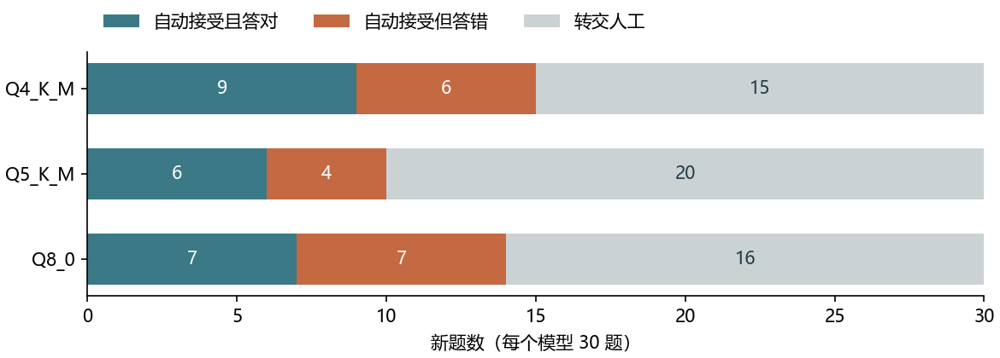
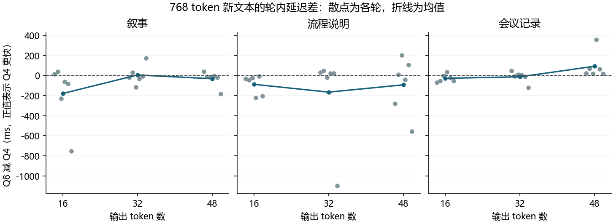

# Stage 10　默认线程配置、分类复核和速度排序验证

2026 年 11 月 6 日在同一台 Ryzen AI 9 H 365 笔记本上完成三项验证。Q4 的 8 个生成线程、16 个批处理线程在四种负载上均通过预设 3% 标准。交换标签可把部分错题转交人工，但两次答案一致的题目仍只有 50%–60% 答对。Q4 与 Q8 的端到端排序对文本和轮次敏感，提示处理时间的变化是本批多数排名反转中最大的测量分量。

新增 360 条正式请求（G 72、H 180、I 108），均成功返回；另有 36 条试跑请求，性能暖机另记。H 和 I 另行重算 [Stage 9](../stage9_deep/README.md) 的 240 条分类响应和 60 条性能响应，历史记录与本次正式样本分开。57 次正式服务进程启动前与结束后均记录为接通电源。Windows 11、10 核 20 线程、31.29 GiB 内存，CPU-only、同一 b11347 后端、上下文 1024。每个正式运行绑定独立通过的试跑；从原始记录第二次生成的 17 个结果文件（含图）逐字节一致。

[事前方案与判定标准](PROTOCOL.md) · [机器、运行绑定与全部汇总](results/summary.json)

## G　8/16 在新负载下能否作为默认配置？

比较 8/8、8/16、16/16，顺序为生成线程 `-t` / 批处理线程 `-tb`。先固定 3% 标准，再用两种新负载以及两种同期重测的锚点验证。在每种负载上，分别计算 6 轮的平均端到端延迟。额外耗时为“8/16 均值除以该负载最低候选均值，再减一”。最后一列将参照改为每轮实际最快配置，反映逐轮波动。工作量由后端逐条核对，缓存命中均为零。

| 输入→输出 token | 8/8（ms） | 8/16（ms） | 16/16（ms） | 最低均值配置 | 8/16 额外耗时 | 同轮差距在 3% 内 |
|---|---:|---:|---:|---|---:|---:|
| 256→64 | 1174.7 ± 150.6 | 1173.6 ± 151.7 | 1344.2 ± 230.1 | 8/16 | 0.00% | 5/6 |
| 512→48 | 1549.0 ± 209.6 | 1546.0 ± 200.8 | 1577.4 ± 170.9 | 8/16 | 0.00% | 4/6 |
| 768→16 | 1751.0 ± 221.1 | 1688.7 ± 220.1 | 1732.7 ± 208.8 | 8/16 | 0.00% | 4/6 |
| 64→96 | 1144.2 ± 147.3 | 1160.7 ± 113.7 | 1409.6 ± 278.5 | 8/8 | 1.45% | 5/6 |

各耗时为均值 ± 样本标准差。两种新负载（256→64、512→48）的最低均值都来自 8/16，与 8/8 的均值实际只差约 1–3 ms。四种负载的最大额外耗时为 1.45%，出现在 64→96；若只运行这种短输入长输出任务，8/8 的平均耗时更低。若在三种候选中只保留一种配置，本机的混合负载可用 8/16。按轮而非按均值看，8/16 在 24 个轮次×负载单元中有 18 次落在同轮最快的 3% 内，不能把均值标准解释成单次延迟保证。

[72 条请求](results/G_requests.csv) · [逐轮配对](results/G_paired.csv) · [三种配置汇总](results/G_loads.csv) · [服务参数、响应和日志](runs/G_formal_20261106_215005_157895/)

## H　标签互换能否标出值得人工复核的题目？

基线为一次原候选顺序的调用。复核策略在同一规则顺序下调用两次，互换两个候选；只有两次都输出有效且相同的标签才接受。表中的“拦下”是指原本单次会答错、现在被转交人工。实验没有模拟人工一定能改对，也未计人工工时。

### 历史记录重算

Stage 9 的每个模型用了 20 道题、两种候选顺序和两种规则顺序。以下将两种规则顺序分开，同一题不重复计入同一统计。原规则顺序是事前指定的主分析。三种模型均拦下错误且保留了一些自动接受题，达到了启动新题验证的条件。

| 模型 | 条件 | 单次答错 | 自动接受 | 接受题中答对 | 拦下错误 | 放过错误 / 全部 | 需人工题数 |
|---|---|---:|---:|---:|---:|---:|---:|
| Q4_K_M | 原规则顺序 | 8 | 10/20 | 7/10 | 5 | 3/20 | 10 |
| Q4_K_M | 反规则顺序 | 8 | 6/20 | 4/6 | 6 | 2/20 | 14 |
| Q5_K_M | 原规则顺序 | 10 | 6/20 | 4/6 | 8 | 2/20 | 14 |
| Q5_K_M | 反规则顺序 | 10 | 8/20 | 4/8 | 6 | 4/20 | 12 |
| Q8_0 | 原规则顺序 | 10 | 8/20 | 5/8 | 7 | 3/20 | 12 |
| Q8_0 | 反规则顺序 | 10 | 8/20 | 4/8 | 6 | 4/20 | 12 |

### 30 道新题

沿用五个标签域和规则原序，每域 6 个新情境，两个金标各 3 题。各模型使用同一固定乱序；同题两次推理串行，15 题原候选顺序先执行，15 题反序先执行。所有 180 个回答均有效，缓存命中均为零。单次成本为同一题原序请求的实测客户端耗时；双次成本为该题第一请求发起至第二响应返回的实测墙钟耗时。

| 模型 | 单次答对 | 自动接受 | 接受题中答对 | 需人工 | 拦下 / 单次错误 | 放过错误 / 全部 | 单次 / 双次均值 ms | 耗时倍数 |
|---|---:|---:|---:|---:|---:|---:|---:|---:|
| Q4_K_M | 15/30 | 15/30 | 9/15 | 15 | 9/15 | 6/30 | 325.2 / 644.2 | 1.98× |
| Q5_K_M | 15/30 | 10/30 | 6/10 | 20 | 11/15 | 4/30 | 578.7 / 1163.0 | 2.01× |
| Q8_0 | 13/30 | 14/30 | 7/14 | 16 | 10/17 | 7/30 | 345.8 / 685.6 | 1.98× |



新题的自动覆盖率为 33.3%–50.0%。Q5 拦下了 15 个单次错误中的 11 个，同时将 9 个原本会答对的题也交给了人工，最终 30 题有 20 题需要复核。即使两次一致，Q4 和 Q5 各有 40% 的自动接受题答错，Q8 为 50%。因此，不一致可作为复核信号；仅凭一致就自动放行，在本任务集上仍会留下较多错题。三模型的串行推理成本均约为原来的两倍，人工预算需要另计。

[新题和金标](holdout.json)（标签与两条规则沿用 [Stage 9 定义](../stage9_deep/new_items.json)） · [历史配对](results/H_historical_pairs.csv) · [新题逐题决策与成本](results/H_new_pairs.csv) · [逐请求判分](results/H_new_requests.csv) · [原始回答](runs/H_formal_20261106_215336_00a5d8/)

## I　Q4 与 Q8 在哪个阶段发生快慢变化？

固定 4/4 线程与 768 个实际输入 token。下表全部指标为同轮 Q8 减 Q4 的配对差，正值表示 Q4 耗时更短。端到端报告 6 轮均值 ± 样本标准差，其余各列为均值。每轮的端到端差都可还原为提示处理差、生成差与剩余差之和；剩余项包含客户端和后端计时边界的差异，不能据其单独推断某一系统瓶颈。

### 历史 60 条请求的重新分解

| 输入 | 输出 token | 端到端差 ms | 提示处理差 ms | 生成差 ms | 剩余差 ms | Q4 / Q8 更快轮数 |
|---|---:|---:|---:|---:|---:|---:|
| 历史文本 | 16 | 11.0 ± 198.7 | -29.0 | 40.5 | -0.47 | 2 / 4 |
| 历史文本 | 32 | -59.0 ± 160.1 | -132.3 | 75.4 | -1.98 | 3 / 3 |
| 历史文本 | 48 | 28.9 ± 196.6 | -84.9 | 118.4 | -4.55 | 4 / 2 |
| 历史文本 | 64 | 293.0 ± 196.4 | 131.0 | 156.9 | 5.07 | 5 / 1 |
| 历史文本 | 96 | 48.0 ± 163.4 | -169.0 | 215.3 | 1.77 | 4 / 2 |

16-token 档第 6 轮，Q8 比 Q4 慢 369.1 ms，其中提示处理多用 309.6 ms，生成多用 59.2 ms，剩余差约 0.3 ms。为描述“同一输出长度为什么会换赢家”，补做一个轮间比较：在同一条件内任选一个 Q8 更快轮和一个 Q8 更慢轮，将两轮的分段差再相减。历史数据共有 38 个这样的轮间组合，提示处理都是推动排序改变最大的正向分量。这 38 个组合共享原始轮次，只是描述性分解，不是 38 个独立重复。

### 三篇新文本

分别从原创叙事、整理流程和会议记录中取前 768 个真实 token。原文并不重复填充，三条 token 序列不同，Q4、Q8 各次分词均与试跑冻结序列一致。每种文本和输出长度测 6 轮，共 108 条请求，均生成指定数量的 token，提示缓存命中均为零。

| 输入 | 输出 token | 端到端差 ms | 提示处理差 ms | 生成差 ms | 剩余差 ms | Q4 / Q8 更快轮数 |
|---|---:|---:|---:|---:|---:|---:|
| 流程说明 | 16 | -88.1 ± 96.6 | -111.2 | 24.2 | -1.06 | 0 / 6 |
| 流程说明 | 32 | -165.7 ± 458.0 | -220.3 | 59.0 | -4.31 | 4 / 2 |
| 流程说明 | 48 | -93.0 ± 278.2 | -167.6 | 71.6 | 2.99 | 3 / 3 |
| 会议记录 | 16 | -27.9 ± 39.4 | -54.8 | 31.7 | -4.86 | 1 / 5 |
| 会议记录 | 32 | -13.1 ± 55.8 | -76.5 | 63.7 | -0.28 | 3 / 3 |
| 会议记录 | 48 | 92.0 ± 131.8 | -23.7 | 117.8 | -2.19 | 6 / 0 |
| 叙事 | 16 | -179.0 ± 296.4 | -202.5 | 20.0 | 3.47 | 2 / 4 |
| 叙事 | 32 | 4.9 ± 95.7 | -47.6 | 52.7 | -0.25 | 2 / 4 |
| 叙事 | 48 | -32.2 ± 77.8 | -98.2 | 73.0 | -6.96 | 1 / 5 |



在全部 9 个新文本×输出长度组合中，Q8 的平均提示处理时间都较短，Q4 的平均生成时间都较短。两阶段差额相抵后，48-token 档的会议记录上 Q4 平均快 92.0 ms，6/6 轮领先；叙事文本上 Q8 平均快 32.2 ms，5/6 轮领先。流程说明的 32-token 档也说明均值和逐轮胜数需要一起看：Q4 赢了 4/6 轮，但第 6 轮 Q8 快了约 1,100 ms，使 Q8 的平均耗时更低，该观测完整保留。新数据共有 52 个同条件、不同赢家的轮间组合，其中 51 个以提示处理、1 个以生成为最大正向分量。现有数据能定位时间记在哪个阶段，但没有隔离温度、频率与后台负载，也不能仅凭三篇材料把延迟变化归因为文体本身。

[三篇输入原文](texts.json) · [历史逐轮分段差](results/I_historical_pairs.csv) · [新文本逐轮分段差](results/I_new_pairs.csv) · [轮间比较明细](results/I_new_contrasts.csv) · [冻结 token ID 与原始响应](runs/I_formal_20261106_215636_51c00c/)

## 复现与核验

使用 Windows、Python 3.12、psutil；绘图另需 Matplotlib 与中文字体。只重算已发布结果，无需模型权重或后端程序。从本目录执行以下命令，将生成新的 `recomputed` 目录。

```powershell
python analyze.py runs/G_formal_20261106_215005_157895 runs/H_formal_20261106_215336_00a5d8 runs/I_formal_20261106_215636_51c00c --output recomputed
python figures.py recomputed
```

重新推理时，按 [Stage 7](../stage7_local/README.md) 准备模型、官方 ZIP 和解压后的后端，保留仓库内 Stage 8、Stage 9 的程序与历史记录。按 G、H、I 顺序各运行 `python G.py pilot`、`python G.py formal runs/<刚产生的G试跑目录>`，H、I 替换为相应文件名与试跑目录。正式执行会核验程序和输入哈希、模型权重、后端和试跑绑定，各次运行独立建目录。
