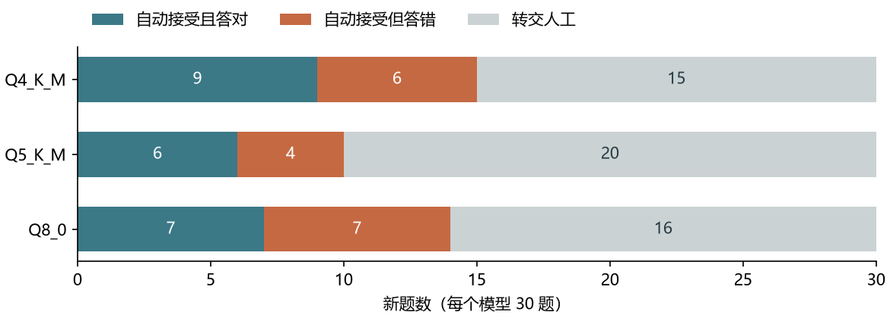
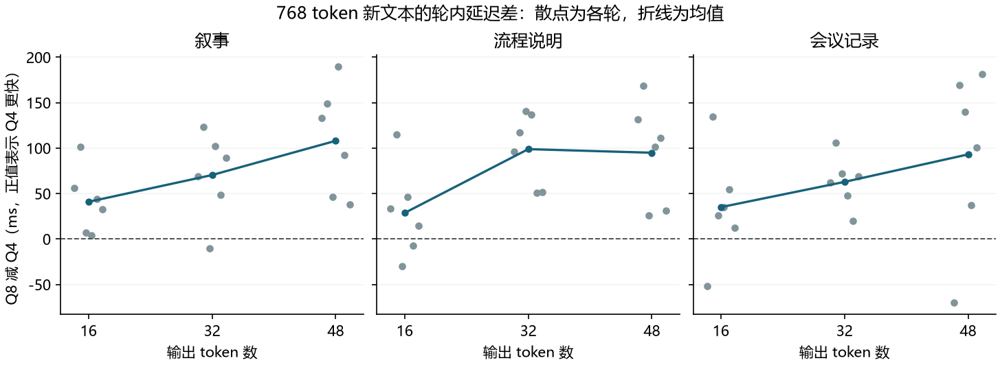

# Stage 10　默认线程、分类复核与延迟分解

2026 年 11 月 27 日在 Stage 1–9 使用的 Ryzen 9 9955HX（16 核 32 线程、31.18 GiB 内存、Windows 11 Build 26100）上完成验证。继续使用 Qwen2.5-0.5B-Instruct 官方 GGUF 与 llama.cpp b11347 CPU 后端。三项新增正式请求共 360 条（G 72、H 180、I 108），另有 36 条试跑请求。57 个正式服务进程启动与退出时均接通电源。H 和 I 的历史对照来自本次同机 Stage 9 的 240 条分类响应和 60 条性能响应。

[事前方案](PROTOCOL.md) · [完整汇总与本机记录](results/summary.json) · [原始运行目录](runs/)

## G　8/16 在四种负载上能否作为默认配置

后续同机补测以 16/16 为唯一待确认配置。60 个新配对轮的八个单侧上限均低于 0，支持在本机四种测试负载与三种候选配置中以 16/16 作为默认配置。[60 轮确认试验](../tools/supplement-stage10-g-1616/REPORT.md)

固定 Q4，比较 8/8、8/16、16/16 三种生成线程和批处理线程组合。每种负载做六轮，事前判据为 8/16 相对各负载最低平均延迟的额外耗时均 ≤3%。前三列耗时是均值 ± 样本标准差，单位 ms。最右列以各轮最快配置为参照。

| 输入 → 输出 token | 8/8 | 8/16 | 16/16 | 最低均值配置 | 8/16 平均额外耗时 | 8/16 同轮差距 ≤3% |
|---|---:|---:|---:|:---:|---:|---:|
| 256 → 64 | 955.5 ± 33.9 | 885.6 ± 39.9 | 888.6 ± 42.8 | 8/16 | 0.00% | 5/6 |
| 512 → 48 | 1054.9 ± 37.8 | 941.7 ± 54.8 | 944.2 ± 12.6 | 8/16 | 0.00% | 4/6 |
| 768 → 16 | 1009.0 ± 34.2 | 843.3 ± 21.3 | 826.4 ± 13.1 | 16/16 | 2.05% | 4/6 |
| 64 → 96 | 1033.3 ± 44.7 | 1068.1 ± 54.6 | 1038.8 ± 52.1 | 8/8 | 3.37% | 2/6 |

8/16 在 3/4 种负载满足预设标准。64→96 的最低均值来自 8/8，8/16 高出 3.37%。逐轮比较时，8/16 在 15/24 个单元内距离同轮最快不超过 3%。按同一算法事后检查 16/16，其四档最大均值开销为 0.54%，可作为本机混合负载优先试用的候选。该观察需要独立重复验证，原预设判定对象是 8/16。

[逐请求数据](results/G_requests.csv) · [配置汇总](results/G_loads.csv) · [同轮比较](results/G_paired.csv) · [正式运行](runs/G_formal_20261127_230001_c5eb06/)

## H　交换标签顺序后的双调用复核

先以本次 Stage 9 E 的 240 条输出复核，按题与规则顺序配对。在原规则顺序下，预设门槛要求至少一个模型既能拦下一次原序错误，也能保留至少一个双答一致的样本。本次对照通过门槛，随后三个模型均评测相同的 30 道预留题。两个回答都有效且一致的样本自动接受，其余转人工。人工处理结果和耗时未知。

Stage 9 E 原规则顺序下，拦下的原序错题为 Q4 5/8、Q5 8/10、Q8 7/10，每个模型均保留了自动接受题。反规则顺序的结果另列于汇总。

| 模型 | 原序答对 | 自动接受（其中错题） | 转人工 | 拦下的原序错题 | 原序单次 / 双调用耗时（ms） |
|---|---:|---:|---:|---:|---:|
| Q4_K_M | 15/30 | 15（6） | 15/30 | 9/15 | 225.2 / 449.6 |
| Q5_K_M | 15/30 | 10（4） | 20/30 | 11/15 | 351.6 / 700.9 |
| Q8_0 | 13/30 | 14（7） | 16/30 | 10/17 | 237.3 / 467.5 |

预留题的自动覆盖率为 33.3%–50.0%。在双答一致且自动接受的题中，Q4、Q5 各有 40% 答错，Q8 为 50%。双调用串行耗时为原序单次的 1.97–2.00 倍。答案不一致可提供分流信号，双答一致样本仍有较高错误率。



[逐题配对](results/H_new_pairs.csv) · [逐请求判分](results/H_new_requests.csv) · [Stage 9 对照重算](results/H_historical_pairs.csv) · [正式运行](runs/H_formal_20261127_230136_5f780f/)

## I　同一输出长度下的延迟分解

固定 4/4 线程与 768 个真实输入 token。将同轮 Q8 减 Q4 的端到端差分解为提示处理、生成和剩余三段。剩余项含 HTTP、解析及两种计时边界的差异。先重算同机 Stage 9 D 的 30 个轮内配对，再测三段新输入，各取前 768 个 token，对 16、32、48 token 的输出分别测六轮。

Stage 9 D 的排序反转集中在 16-token 档。该档 4 轮 Q4 更快、2 轮 Q8 更快，构成 8 个异向轮间组合，提示处理在这 8 个组合中均是推动反转的最大正向分量。单轮的绝对差最大值为 52.7 ms，其中生成差 34.4 ms。单轮耗时差与两轮之间的排名变化使用不同的分解对象。

| 输入 | 输出 token | 端到端差（均值 ± 样本标准差，ms） | 提示处理差（ms） | 生成差（ms） | Q4 / Q8 更快轮数 |
|---|---:|---:|---:|---:|---:|
| 流程说明 | 16 | 28.7 ± 50.3 | -16.8 | 42.4 | 4 / 2 |
| 流程说明 | 32 | 98.9 ± 40.1 | 1.3 | 91.1 | 6 / 0 |
| 流程说明 | 48 | 95.0 ± 56.5 | -26.7 | 123.8 | 6 / 0 |
| 会议记录 | 16 | 35.1 ± 60.7 | -3.2 | 37.6 | 5 / 1 |
| 会议记录 | 32 | 62.9 ± 28.3 | -28.1 | 94.2 | 6 / 0 |
| 会议记录 | 48 | 93.1 ± 95.4 | -7.7 | 98.2 | 5 / 1 |
| 叙事 | 16 | 41.0 ± 35.8 | 6.0 | 33.6 | 6 / 0 |
| 叙事 | 32 | 70.4 ± 47.2 | -24.2 | 83.1 | 5 / 1 |
| 叙事 | 48 | 108.1 ± 59.7 | -12.2 | 129.0 | 6 / 0 |

在三篇文本和三档输出组成的九个条件下，Q4 平均端到端耗时均较低，54 个轮内配对有 49 个由 Q4 领先。Q4 在九个条件的平均生成耗时均较低，Q8 在七个条件的平均提示处理耗时较低。新数据有 23 个同条件下的异向轮间组合，18 个以提示处理、5 个以生成为最大正向分量。组合共享实际轮次，仅用于描述分段贡献。温度、频率和后台负载仍可能影响这些计时。



[原始文本](texts.json) · [Stage 9 历史配对](results/I_historical_pairs.csv) · [本阶段配对](results/I_new_pairs.csv) · [本阶段轮间比较](results/I_new_contrasts.csv) · [正式运行](runs/I_formal_20261127_230308_75186d/)

## Windows 复现

按 [Stage 7](../stage7_local/README.md) 准备官方后端与权重。Stage 10 读取本次 Stage 8 的冻结序列及 Stage 9 汇总绑定的 D/E 正式记录。H/I 保存对应 Stage 9 完成记录的 SHA256。三项先试跑再正式采集。

```powershell
python G.py pilot
python G.py formal "runs/<G 试跑目录>"
python H.py pilot
python H.py formal "runs/<H 试跑目录>"
python I.py pilot
python I.py formal "runs/<I 试跑目录>"
```

只复核已提交结果时无需权重和推理后端。Python 3.12、psutil 用于复现脚本，matplotlib 和中文字体用于重绘图表。

```powershell
python analyze.py runs/G_formal_20261127_230001_c5eb06 runs/H_formal_20261127_230136_5f780f runs/I_formal_20261127_230308_75186d
python figures.py recomputed
```
