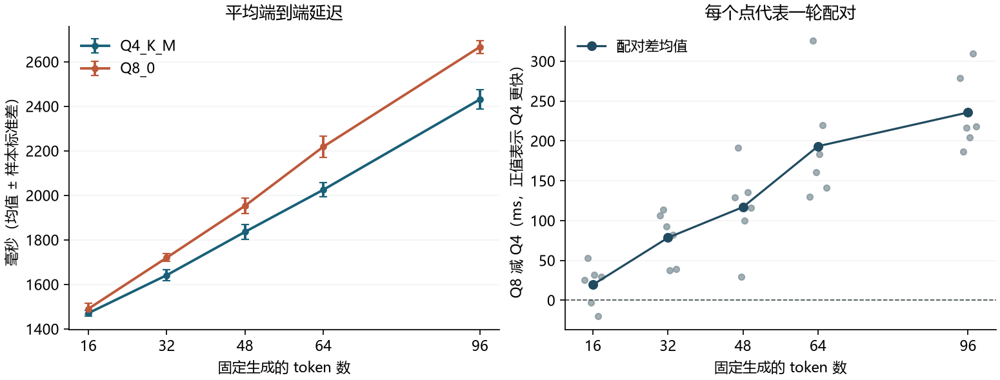
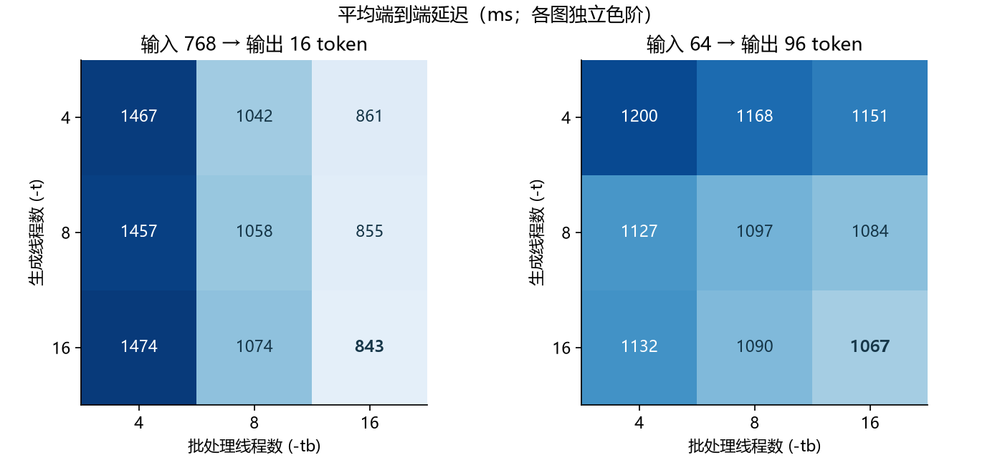

# Stage 9　输出长度、标签顺序和线程配置

2026 年 11 月 27 日在 Stage 1–8 使用的 Ryzen 9 9955HX（16 核 32 线程、31.18 GiB 内存、Windows 11 Build 26100）上完成三项同机复测。沿用官方 llama.cpp b11347 CPU 后端与 Stage 7 的模型权重。三项正式运行共 462 条请求（60、240、162），另有 40 条试跑请求。正式运行的 96 个服务进程启动和退出时均接通电源。Stage 9 从本次 Stage 8 B 的正式记录读取冻结 token 序列。

[事前方案](PROTOCOL.md) · [汇总与运行绑定](results/summary.json) · [原始运行目录](runs/)

## D　固定 768 token 输入时的输出长度对照

固定 4 个生成线程及 4 个批处理线程。Q4 和 Q8 在同一轮按相同顺序测五档输出，各版本独立暖机。下表为六轮均值 ± 样本标准差，差值是同轮 Q8 减 Q4，单位 ms。

| 输出 token | Q4 | Q8 | 轮内配对差 | Q4 / Q8 更快轮数 |
|---:|---:|---:|---:|---:|
| 16 | 1471.2 ± 13.6 | 1490.7 ± 24.9 | 19.5 ± 26.2 | 4 / 2 |
| 32 | 1641.7 ± 25.6 | 1720.3 ± 17.5 | 78.5 ± 33.1 | 6 / 0 |
| 48 | 1836.2 ± 34.1 | 1953.2 ± 34.1 | 117.0 ± 52.9 | 6 / 0 |
| 64 | 2025.3 ± 32.1 | 2218.7 ± 47.2 | 193.4 ± 72.5 | 6 / 0 |
| 96 | 2431.4 ± 43.0 | 2667.1 ± 28.7 | 235.8 ± 47.7 | 6 / 0 |

本机这条输入上的五个测点，Q4 的平均端到端耗时都更短。16 token 档有两轮 Q8 更快，32–96 token 的四档均为 Q4 六轮领先。此次结果不足以支持原方案提出的约 44 token 固定分界。测点之间与其他文本仍需按实际负载配对测量。



[60 条请求与分段计时](results/D_requests.csv) · [逐轮配对](results/D_paired.csv) · [正式运行](runs/D_formal_20261127_225107_f90d4e/)

## E　候选标签与规则说明的顺序效应

20 道题各接受四种提示，独立交换候选列表或规则句，其余条件固定。三个模型共 240 条正式回答，均有效。表中的效应是把原始标签 A 从次位移至首位后选择 A 的比例变化，单位为百分点。每题先对另一因素的两种顺序取平均，再对题目取平均。

| 模型 | 候选列表效应 | 规则说明效应 | 四序均选候选首位 | 四序均选规则首位 | 正确数 |
|---|---:|---:|---:|---:|---:|
| Q4_K_M | 60 | 20 | 8/20 | 0/20 | 46/80 |
| Q5_K_M | 65 | 35 | 8/20 | 2/20 | 42/80 |
| Q8_0 | 60 | 30 | 8/20 | 2/20 | 42/80 |

三个模型在本题集上均表现为候选列表顺序的平均影响更大。部分题始终跟随第一条规则，也有题在四种提示下输出相同标签。这些均为可观察的输出模式，解释范围是当前五个中文二分类域与提示格式。

[测试题与金标](new_items.json) · [逐题四序输出](results/E_items.csv) · [全部判分](results/E_responses.csv) · [正式运行](runs/E_formal_20261127_225329_eadd53/)

## F　生成线程与批处理线程独立调优

固定 Q4_K_M。生成线程和批处理线程各取 4、8、16，九种组合在两种负载上各测九轮。固定负载比较同轮差，独立调参的结论限于本机、指定负载和测试档位。

| 输入 → 输出 token | 4/4 基线均值（ms） | 均值最低配置 | 最低均值 ± 标准差（ms） | 相对基线缩短 | 更快轮数 |
|---|---:|---:|---:|---:|---:|
| 768 → 16 | 1467.4 | 16/16 | 843.1 ± 14.9 | 624.4（42.5%） | 9/9 |
| 64 → 96 | 1199.7 | 16/16 | 1066.7 ± 20.2 | 133.0（11.1%） | 9/9 |

两组负载的最低平均延迟都出现在 16/16。8/16 都排第二，长输入短输出为 855.0 ms，短输入长输出为 1083.9 ms。Stage 10 用四组负载继续检验 8/16 离每组最佳均值是否都在预设的 3% 内。



[162 条正式请求](results/F_requests.csv) · [配置汇总](results/F_cells.csv) · [同轮配对](results/F_paired.csv) · [单因素差值](results/F_one_factor.csv) · [正式运行](runs/F_formal_20261127_225509_2faa23/)

## Windows 复现

按 [Stage 7](../stage7_local/README.md) 准备权重和后端。脚本从 Stage 8 的 results/summary.json 绑定 B 的正式 run 和 token 序列。试跑与正式采集分别存档。

```powershell
python D.py pilot
python D.py formal "runs/<D 试跑目录>"
python E.py pilot
python E.py formal "runs/<E 试跑目录>"
python F.py pilot
python F.py formal "runs/<F 试跑目录>"
```

离线核验无需权重和后端二进制。为 Stage 10 绑定新采集的同机结果时，在独立实验目录用新 run 重算，指定 --output results。

```powershell
python analyze.py runs/D_formal_20261127_225107_f90d4e runs/E_formal_20261127_225329_eadd53 runs/F_formal_20261127_225509_2faa23
python figures.py recomputed
```
