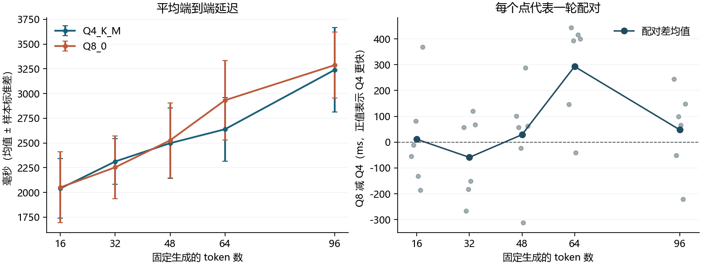
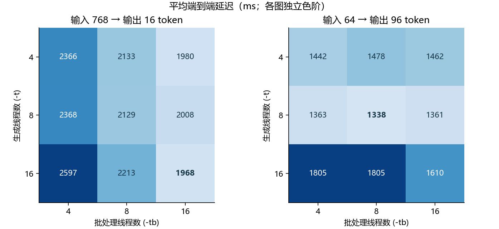

# Stage 9　量化速度、标签顺序与线程配置的深入实验

2026 年 11 月 6 日，在 Ryzen AI 9 H 365 笔记本上依次完成三个对照实验。Q4 和 Q8 在 768 token 输入上的延迟差随输出长度和轮次变化，这组测量不足以支持固定的 44-token 切换阈值。分类时，调换候选列表产生的平均影响大于调换规则说明，但在部分题目上模型会随规则说明改变回答。Q4 的最低平均延迟也取决于负载：长输入短输出时为 16/16 线程，短输入长输出时为 8/8。

三项正式运行共 462 个请求（60、240、162），另有 40 次试跑请求，服务暖机请求单独保留。正式运行的 96 个服务进程在启动前和退出后均记录为接通电源。Windows 11、10 核 20 线程、31.29 GiB 内存，使用官方 b11347 CPU 后端和同一 0.5B 模型的预量化 GGUF。全部正式请求均成功返回。分析从已绑定运行的原始响应、计时戳和执行顺序重建；重复生成的 13 份结果文件（含两张图）逐字节一致。

[固定方案](PROTOCOL.md) · [机器与运行记录、总汇总](results/summary.json) · [上一阶段结果](../stage8_extensions/README.md)

## D　768 token 输入下，输出多长时 Q4 会更快？

使用 Stage 8 的同一串 768 个输入 token，4 线程，固定输出长度。每轮交替安排 Q4 和 Q8 的进程顺序，两个版本在同轮测相同的五档输出长度。下表的差值先在轮内计算，再对 6 轮求均值；正值表示 Q4 更快。单位均为毫秒，± 为样本标准差。每条请求的实际输入、输出与计划一致，提示缓存命中数均为零。

| 输出 token | Q4 平均延迟 | Q8 平均延迟 | Q8 减 Q4 配对差 | Q4 / Q8 更快轮数 |
|---:|---:|---:|---:|---:|
| 16 | 2040.4 ± 300.5 | 2051.4 ± 357.9 | 11.0 ± 198.7 | 2 / 4 |
| 32 | 2312.9 ± 230.9 | 2253.9 ± 315.4 | -59.0 ± 160.1 | 3 / 3 |
| 48 | 2497.7 ± 357.0 | 2526.5 ± 379.9 | 28.9 ± 196.6 | 4 / 2 |
| 64 | 2638.7 ± 321.9 | 2931.6 ± 402.2 | 293.0 ± 196.4 | 5 / 1 |
| 96 | 3239.0 ± 428.1 | 3287.1 ± 333.3 | 48.0 ± 163.4 | 4 / 2 |



Stage 8 的粗略外推给出了约 44 token 的候选分界。本轮 32 token 时 Q8 平均快 59.0 ms，48 token 时 Q4 平均快 28.9 ms，但 16 token 时 Q4 的均值也略低，均值排序没有随长度单调变化。以 16 token 为例，Q8 在 6 轮中赢了 4 轮，有一轮却比 Q4 慢约 369 ms，足以改变平均值排序。所有观测均保留。64 token 是 Q4 优势最明显的测点（5/6 轮领先），仍有一轮反向。用这组数据选型时应对实际输入和输出长度做配对测量；两测点之间的直线只是连线。

[60 条端到端与后端分段计时](results/D_requests.csv) · [每一轮的配对差](results/D_paired.csv) · [配对统计](results/D_difference.csv) · [原始响应和日志](runs/D_formal_20261106_211741_cf5902/)

## E　候选列表和规则说明，哪一处顺序对回答影响更大？

五个标签域各编写 4 个新情境，各域的两种金标等量。每题的两条规则句均写出各自适用条件，可单独阅读。同一情境独立交换候选列表和规则句，得到四种提示；三个模型按同一固定乱序回答。所有 240 条回答都正常结束、精确匹配一个标签，提示缓存命中数均为零。

| 量化版本 | 四次均选候选首位 | 四次均选规则首位 | 始终同一标签 | 其他有效模式 | 至少一序无效 | 首位冲突时选候选 / 规则 | 正确数 |
|---|---:|---:|---:|---:|---:|---:|---:|
| Q4_K_M | 8 | 0 | 4 | 8 | 0 | 28 / 12 | 46/80 |
| Q5_K_M | 8 | 2 | 0 | 10 | 0 | 26 / 14 | 42/80 |
| Q8_0 | 8 | 2 | 2 | 8 | 0 | 26 / 14 | 42/80 |

前五个计数按题，每行合计 20 道。首位冲突有 40 次请求，正确数按 80 次请求计算。下表给出另一个量化角度：当把原始标签 A 从某一处的次位换至首位时，模型选择 A 的比例变化了多少个百分点。每题先对另一因素的两种顺序求平均，再对 20 题求均值。四个正确数的列名中，第一位对应候选、第二位对应规则；0 表示原序，1 表示反序。

| 版本 | 有效题数 | 候选顺序效应（百分点） | 规则顺序效应（百分点） | 00 正确 | 01 正确 | 10 正确 | 11 正确 |
|---|---:|---:|---:|---:|---:|---:|---:|
| Q4_K_M | 20 | 60.0 | 20.0 | 12/20 | 12/20 | 12/20 | 10/20 |
| Q5_K_M | 20 | 65.0 | 35.0 | 10/20 | 10/20 | 12/20 | 10/20 |
| Q8_0 | 20 | 60.0 | 30.0 | 10/20 | 10/20 | 12/20 | 10/20 |

例如第 4-1 题是对盲文导览图的赞扬，金标为“正面”。Q5 在正面规则排第一时两次均答“正面”，在负面规则排第一时两次均答“负面”，不论候选列表先给哪个标签。另一方面，每个模型都有 8 道题在全部四个条件下只选候选首位。这两种行为能够在同一组题目中同时出现。观察范围为当前中文二分类任务、标签和提示，不能据此确定模型内部的决策机制。

[20 个新情境、规则与金标](new_items.json) · [240 条逐请求输出](results/E_responses.csv) · [逐题四种回答与效应](results/E_items.csv) · [完整提示、原始响应和日志](runs/E_formal_20261106_212113_018921/)

## F　分别设置生成线程和批处理线程

固定 Q4，独立改变生成线程 `-t` 与批处理线程 `-tb`。9 轮各运行全部 9 种配置，每种配置在各个轮内位置恰好出现一次；每个进程都测两种负载。下表为 9 次均值，延迟同时给出样本标准差。完整记录含各负载对应的两种吞吐及每轮配对差。

| -t | -tb | 768→16 端到端 ms | 64→96 端到端 ms | 768→16 提示 token/s | 64→96 生成 token/s |
|---:|---:|---:|---:|---:|---:|
| 4 | 4 | 2365.8 ± 289.7 | 1441.5 ± 110.7 | 365.7 | 76.6 |
| 4 | 8 | 2133.3 ± 222.7 | 1478.1 ± 141.7 | 413.8 | 73.4 |
| 4 | 16 | 1979.6 ± 134.2 | 1462.3 ± 101.1 | 458.2 | 73.5 |
| 8 | 4 | 2368.1 ± 218.0 | 1362.6 ± 113.2 | 359.0 | 85.6 |
| 8 | 8 | 2129.3 ± 207.3 | 1338.4 ± 92.7 | 405.1 | 82.0 |
| 8 | 16 | 2008.4 ± 151.7 | 1361.2 ± 113.2 | 441.2 | 80.5 |
| 16 | 4 | 2597.3 ± 406.9 | 1805.1 ± 445.2 | 339.1 | 66.5 |
| 16 | 8 | 2213.3 ± 264.8 | 1805.3 ± 639.2 | 397.6 | 65.9 |
| 16 | 16 | 1968.1 ± 174.1 | 1610.0 ± 284.0 | 451.1 | 68.6 |



- **长输入短输出**。平均用时最低的实测配置是 -t 16 / -tb 16，为 1968.1 ms；4/4 为 2365.8 ms。相对基准平均缩短 397.8 ms（16.8%），9/9 轮更快。第二低均值来自 4/16，比最低均值多 11.5 ms。
- **短输入长输出**。平均用时最低的实测配置是 -t 8 / -tb 8，为 1338.4 ms；4/4 为 1441.5 ms。相对基准平均缩短 103.1 ms（7.2%），8/9 轮更快。第二低均值来自 8/16，比最低均值多 22.8 ms。

保持生成线程为 4 时，把批处理线程从 4 增到 16，使长输入短输出平均缩短 386.2 ms，9 轮全部改善。反过来，保持批处理线程为 4，把生成线程从 4 增到 8，使短输入长输出平均缩短 78.9 ms，也是 9 轮全部改善。长输入任务中 4/16 的平均耗时与 16/16 相差约 12 ms。本轮只比较列出的档位，未测功耗、锁频或固定核心亲和性，亦未隔离后台负载；最低观测均值不等同于全局最优或更节能。

[162 条逐请求计时](results/F_requests.csv) · [单因素配对对照](results/F_one_factor.csv) · [逐轮相对 4/4 的差值](results/F_paired.csv) · [原始响应与日志](runs/F_formal_20261106_212419_f7a45d/)

## Windows 复现

使用 Python 3.12、psutil，绘图使用 Matplotlib 和中文字体。重新运行推理前，按 [Stage 7 说明](../stage7_local/README.md) 准备锁定版本的三个 GGUF、官方 ZIP 及其在 `assets/backend` 下的解压内容。脚本直接使用仓库中的 Stage 8 token ID 文件和共享控制代码。每项先运行 pilot，然后把其输出的实际试跑目录传给 formal，例如从本目录执行以下命令。替换尖括号内的目录名。

```powershell
python D.py pilot
python D.py formal runs/<D试跑目录>
python E.py pilot
python E.py formal runs/<E试跑目录>
python F.py pilot
python F.py formal runs/<F试跑目录>
```

仅复核已提交结果时，无需模型权重或后端二进制。在本目录运行下列命令，输出到新的 `recomputed` 目录，可与 [正式结果](results/) 比对。

```powershell
python analyze.py runs/D_formal_20261106_211741_cf5902 runs/E_formal_20261106_212113_018921 runs/F_formal_20261106_212419_f7a45d --output recomputed
python figures.py recomputed
```
